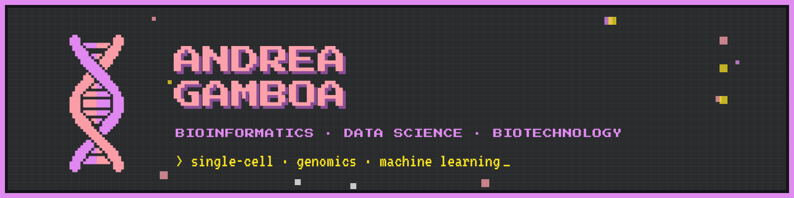
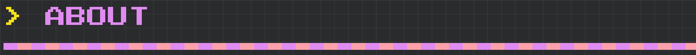
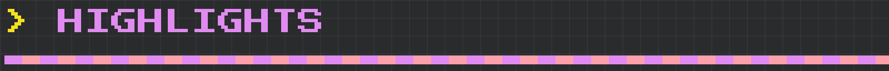
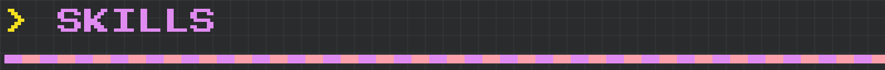
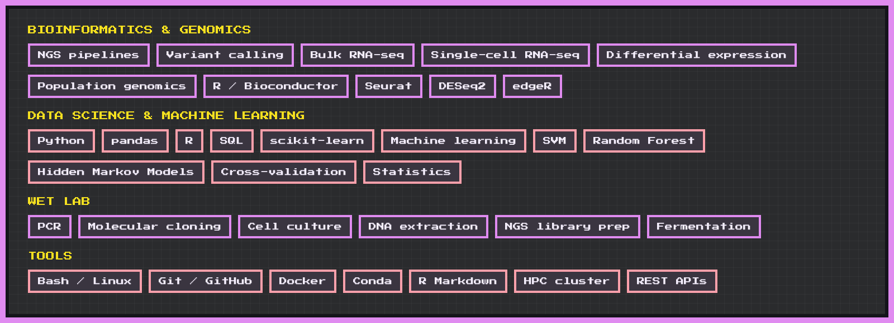
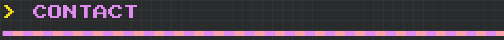

**Bioinformatician · MSc Bioinformatics, University of Bologna**

Open to roles in bioinformatics, computational biology and data science.

[🌐 Portfolio](https://agamboa7.github.io) · [💼 LinkedIn](https://www.linkedin.com/in/andygamboa7/) · [📄 CV](https://agamboa7.github.io/CV_Andrea_Gamboa.pdf) · [✉️ Email](mailto:andygaamboa7@gmail.com)

I work with genomics, single-cell transcriptomics and machine learning, turning biological data into reliable, reproducible insight. What drives me is finding real significance in the data I analyse: results that hold up statistically and mean something biologically. I want to apply this to translational healthcare research, from biomarker discovery and precision medicine to drug and vaccine development, with a particular interest in cancer and rare diseases.

- 📄 **Published:** data curation acknowledged in *Genome Biology and Evolution* (2025) for a population-genomics study of Mexican Indigenous populations ([paper](https://pmc.ncbi.nlm.nih.gov/articles/PMC11954594/))
- 🧬 **MSc thesis:** single-cell RNA-seq of keratinocytes from EEC syndrome (a rare disease), 13,235 cells from 4 samples, plus a benchmark of differential-expression methods against bulk RNA-seq
- 🤖 **Machine learning:** SVM for signal peptide prediction reaching 97% accuracy
- 🤝 **BITS Biohackathon 2026** (Padova): network reverse-engineering project in a team of four

- 🌐 Portfolio: [agamboa7.github.io](https://agamboa7.github.io)
- 💼 LinkedIn: [andygamboa7](https://www.linkedin.com/in/andygamboa7/)
- ✉️ Email: andygaamboa7@gmail.com
